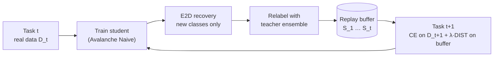

# Data Distillation for Continual Learning

Replay-based continual learning in which the replay buffer holds **synthetic images produced by dataset distillation** instead of real past samples. The method used is **E2D (Exploration–Exploitation Distillation)**, integrated into the [Avalanche](https://avalanche.continualai.org/) continual-learning library as a custom plugin and evaluated on Split Tiny-ImageNet.

Final-year engineering project (PFA), *Data and Decision Systems*, ENET'Com Sfax, Université de Sfax.

**Authors:** Rima Fourati, Yasmine Abdelhedi
**Supervisors:** Mme Sonda Ammar, Mme Mariem Regaieg

---

## Motivation

A model trained on a stream of tasks tends to overwrite what it learned before (**catastrophic forgetting**). Replay methods fight this by storing real samples from past tasks, but that:

- depends heavily on memory size and grows costly as tasks accumulate,
- stores raw past data, which is a problem in sensitive domains (medical, banking),
- uses the buffer directly, without optimizing what it contains.

**Question:** how can we preserve past knowledge while reducing the amount of stored data?

**Idea:** after each task, distill its classes into a few optimized synthetic images with soft labels, and replay those instead of real images.

## Results

Split Tiny-ImageNet, 20 classes, 5 experiences of 4 classes, ResNet-18 student.

| Strategy | Memory | Accuracy ↑ | Forgetting ↓ |
|---|---|---|---|
| Random Replay | 200 real images | **71.00 %** | 24.00 % |
| E2DReplay, 1 IPC | 20 synthetic images | 44.10 % | 58.25 % |
| E2DReplay, 10 IPC | 200 synthetic images | 61.00 % | 33.88 % |
| E2DReplay, 50 IPC | 1,000 synthetic images | 69.40 % | **15.75 %** |

*IPC = synthetic images per class.*

- Accuracy rises and forgetting falls steadily with IPC: from 1 to 50 IPC, forgetting drops from 58.25 % to 15.75 %.
- At 50 IPC, E2DReplay forgets less than Random Replay (15.75 % vs 24.00 %) and comes within 1.6 points of its accuracy, **without storing any real image**.

Per-experience accuracy and run details: [`results/README.md`](results/README.md).

## Method



**1. Recover (E2D synthesis).** For each new class, synthetic images are optimized in pixel space so that the teachers classify them correctly and their BatchNorm statistics match those of the real task data.
- *Exploration phase* (first K iterations): random multi-crop updates; crops with high loss are kept in a per-image memory.
- *Exploitation phase*: optimization focuses on the stored high-loss crops, so iterations are spent on the informative regions. Optimization stops early once no high-loss crop remains.

BN statistics are computed **only from the current task's images**, so recovery never sees data from other tasks.

**2. Relabel.** Each synthetic image is passed through the teacher ensemble (ResNet-18 + ResNet-50) under several random augmentations. The averaged logits are stored as soft labels, which carry inter-class information that one-hot labels lose.

**3. Replay.** When training on the next task, every gradient step sees a real mini-batch plus the **entire** synthetic buffer. The loss combines both:

$$\mathcal{L} = \mathcal{L}_{CE}(\mathcal{D}_t) + \lambda \cdot \mathcal{L}_{DIST}(\mathcal{B}_{<t})$$

where DIST is a correlation-based distillation loss between the student logits and the stored teacher logits.

### Integration into Avalanche

The pipeline is an Avalanche `SupervisedPlugin` ([`src/cl_plugin.py`](src/cl_plugin.py)) added to the standard `Naive` strategy. It works through three hooks:

| Hook | Role |
|---|---|
| `before_training_exp` | Merges real task data with the synthetic buffer into `(image, label, task_id, soft_label, is_replay)` batches, using full-buffer replay |
| `after_forward` | Adds the KD loss on samples flagged `is_replay` |
| `after_training_exp` | Runs E2D recovery for the new classes, relabels with the teachers, and saves JPEGs, soft labels and the buffer index |

Other engineering details:
- **Subprocess isolation.** Recovery runs as a separate process, after the student and optimizer state are moved off the GPU, so it gets the full GPU memory.
- **Label-order fix.** A class-index remapping fixes a silent mismatch between Avalanche's Tiny-ImageNet class order (`wnids.txt`) and the teachers' class order (sorted `ImageFolder`).
- **Resume support.** Checkpoints and the buffer index are saved after every experience, so a run can resume after a Kaggle session expires.

## Experimental setup

Configuration of the reported runs (only IPC and strategy change between rows):

| | |
|---|---|
| Benchmark | Split Tiny-ImageNet, first 20 classes, 5 experiences, seed 42 |
| Student | ResNet-18 initialised from the Tiny-ImageNet checkpoint, frozen backbone, trainable 20-way linear head |
| Teachers | ResNet-18 and ResNet-50 trained on Tiny-ImageNet (200 epochs) |
| Training | 50 epochs per experience, SGD (Nesterov, momentum 0.875), lr 0.05 with per-experience cosine schedule, batch 256 |
| Recovery | 300 iterations, K = 150, Adam lr 0.01, random-noise initialisation |
| Relabel / KD | 5 augmented views, DIST loss with T = 4, λ = 1.0 |
| Hardware | Kaggle, 2× Tesla T4 (10 IPC run: 0.77 h) |

## Repository structure

```
├── src/
│   ├── cl_train.py          # entry point: benchmark, student, strategies, summary
│   ├── cl_plugin.py         # E2DReplayPlugin: recover → relabel → replay + KD loss
│   ├── cl_buffer.py         # disk-backed synthetic replay buffer (fixed or global budget)
│   ├── recover_cl.py        # E2D synthesis restricted to one task's classes
│   ├── utils.py             # BN/Conv feature hooks, LR policies, image utilities
│   ├── tiny_teachers.py     # Tiny-ImageNet ResNet loaders and class-order remapping
│   └── normalization.py     # shared normalisation presets and transforms
├── notebooks/
│   └── e2d_kaggle_runner.ipynb   # Kaggle runner with the full log of the 10 IPC run
├── results/                 # results tables and run logs
├── checkpoints/             # teacher weights (not tracked, see checkpoints/README.md)
├── scripts/
│   └── setup_env.bat        # Windows environment setup
└── requirements.txt
```

## Getting started

```bash
# 1. Install PyTorch for your CUDA version, then the dependencies
pip install torch==2.5.1+cu124 torchvision==0.20.1+cu124 --index-url https://download.pytorch.org/whl/cu124
pip install -r requirements.txt

# 2. Put the teacher weights in checkpoints/tinyimagenet/ (see checkpoints/README.md)
#    and download Tiny-ImageNet-200 (folder with wnids.txt and train/)

# 3. Run E2DReplay at 10 IPC
python src/cl_train.py \
  --dataset tiny --tiny-data-root /path/to/tiny-imagenet \
  --strategy e2d --n-experiences 5 --n-classes 20 --seed 42 \
  --student-arch resnet18 \
  --student-tiny-checkpoint checkpoints/tinyimagenet/rn18_200ep.pth --freeze-backbone \
  --epochs 50 --lr 0.05 --batch-size 256 \
  --ipc 10 --K 150 --recover-iterations 300 --recover-lr 0.01 --recover-batch-size 16 \
  --relabel-views 5 --kd-loss dist --kd-weight 1.0 --kd-temperature 4.0 \
  --gpu-id 0
```

- Use `--strategy random` for the Random Replay baseline, `--strategy all` for both.
- Change `--ipc` for the other buffer sizes.
- Add `--resume` to continue an interrupted run and `--debug-diagnostics` for per-batch tensor and loss checks.

## Limitations

- **Pretrained on all classes.** The teachers and the student backbone were pretrained on all 200 Tiny-ImageNet classes, and the backbone is frozen. The results therefore measure forgetting in the classifier head on top of fixed pretrained features, not representation learning from scratch.
- **Small scale.** Each result comes from a single seed on a 20-class subset.
- **Generation cost.** Synthesis takes about 60 % of run time (≈ 5.7 min per experience at 10 IPC on 2× T4).

## Perspectives

- Scale to the full Tiny-ImageNet-200 benchmark.
- Reduce generation time.
- Study more memory budgets and buffer sampling strategies, including equal-budget comparisons with real replay.

## References

- E2D (Exploration–Exploitation Distillation). `recover_cl.py` adapts the original E2D recovery code, itself derived from [Data-Free-NAS](https://github.com/liuzechun/Data-Free-NAS).
- B. Zhao, H. Bilen. [*Dataset Condensation with Differentiable Siamese Augmentation*](https://arxiv.org/abs/2102.08259), ICML 2021.
- W. Liao et al. [*Data-Distill-Net: A Data Distillation Approach Tailored for Replay-based Continual Learning*](https://arxiv.org/abs/2505.20135), 2025.
- [Avalanche](https://github.com/ContinualAI/avalanche): an end-to-end library for continual learning.
- [Awesome Dataset Distillation](https://github.com/Guang000/Awesome-Dataset-Distillation).
- Tiny-ImageNet teacher checkpoints: [zeyuanyin/tiny-imagenet](https://github.com/zeyuanyin/tiny-imagenet).
